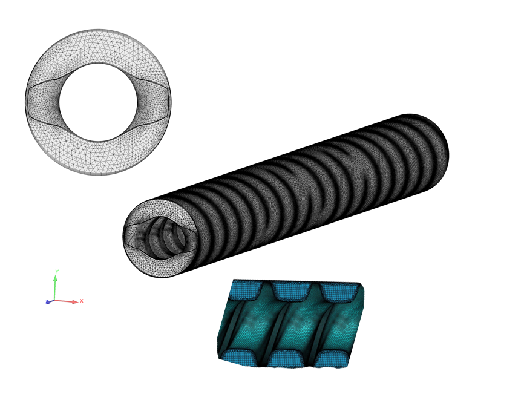
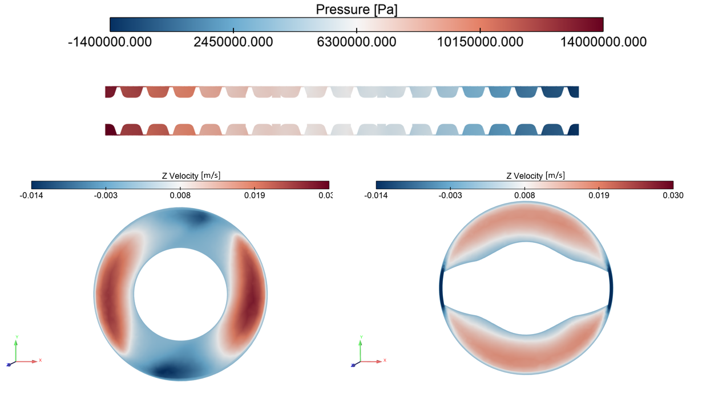
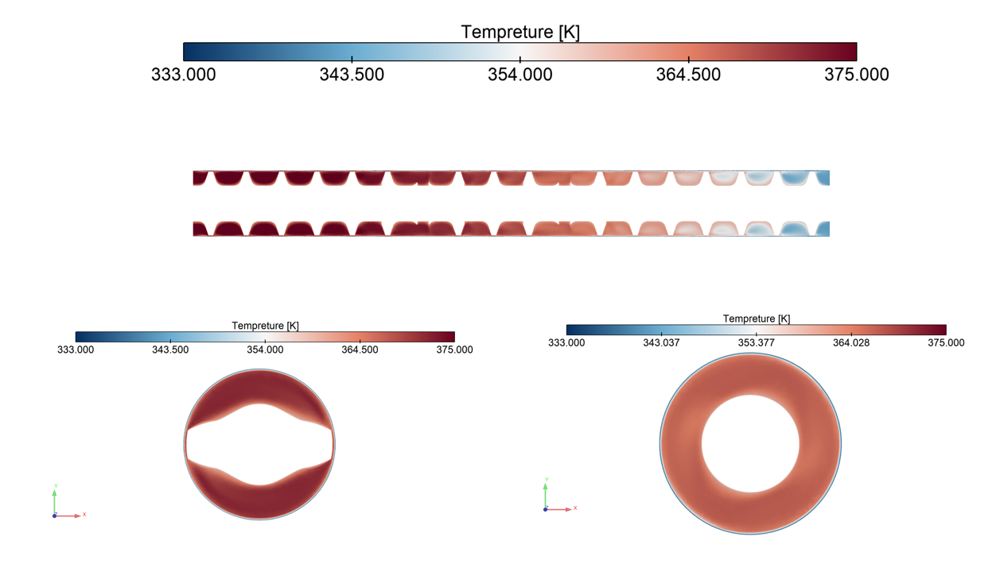
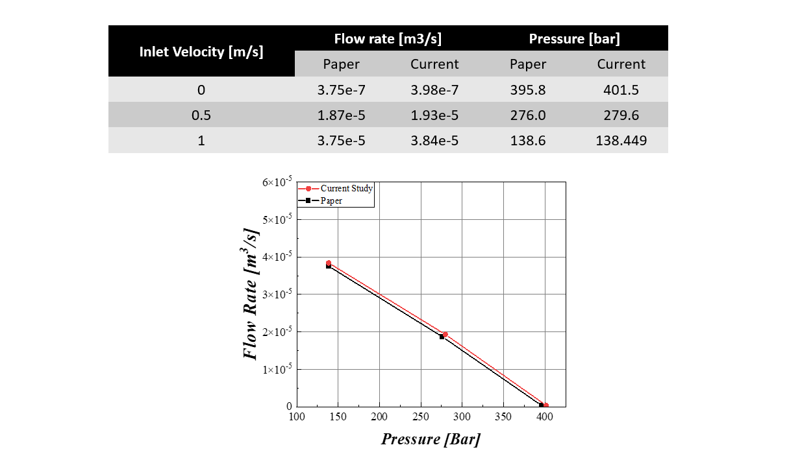

# CFD Analysis of Material Flow in a Single-Screw Extruder

 1. Project Overview

This project investigates material flow in a single-screw extruder using ANSYS Fluent. The simulation focuses on the pressure and temperature fields within the extrusion domain and the effect of inlet velocity on flow rate and pressure.

The screw geometry was based on a published master's thesis by D'Intinosante (2020). The model was set up independently in ANSYS Fluent, and selected numerical results were compared with those reported in the reference study.

 2. Objectives

- Model material flow through a single-screw extruder.
- Represent non-Newtonian viscosity using a power-law model.
- Examine the effect of screw rotation and inlet velocity on the flow.
- Visualize the pressure and temperature fields.
- Compare the simulated flow rate and pressure with the reference results.

 3. Model Description

Material is conveyed through the helical channel between the screw and the barrel. Screw rotation produces drag flow, while the imposed inlet flow affects the resulting pressure distribution and throughput.

The model includes the screw geometry, the surrounding flow domain, and the boundary conditions defined in ANSYS Fluent.

 4. Governing Equations

Continuity equation

$$\nabla \cdot \mathbf{u} = 0$$

Momentum equation

$$\rho \left( \frac{\partial \mathbf{u}}{\partial t} + \mathbf{u}\cdot\nabla\mathbf{u} \right) = -\nabla p + \nabla\cdot\boldsymbol{\tau} + \rho\mathbf{g}$$

Energy equation

$$\rho c_p \left( \frac{\partial T}{\partial t} + \mathbf{u}\cdot\nabla T \right) = \nabla\cdot(k\nabla T) + \Phi$$

where $\Phi$ represents viscous dissipation.

Power-law viscosity model

$$\mu = K\,\dot{\gamma}^{\,n-1}$$

Here, $K$ is the consistency index, $n$ is the power-law index, and $\dot{\gamma}$ is the shear rate. For $n<1$, the material exhibits shear-thinning behavior.

 5. Model Setup

| Parameter | Value |
|---|---|
| CFD software | ANSYS Fluent |
| Extruder type | Single-screw |
| Viscosity model | Power law |
| Density | 1170 kg/m³ |
| Screw rotational speed | 30 rpm |
| Inlet normal velocity | 0, 0.5, and 1 m/s |
| Outlet boundary condition | Outflow |
| Barrel wall condition | Zero wall velocity |

 6. Simulation Results

 6.1 Screw Geometry

The geometry used to define the screw and the flow domain.

 6.2 Computational Mesh

The mesh used to discretize the flow domain.

 6.3 Pressure Contour

Pressure distribution within the extrusion domain.

 6.4 Temperature Contour

Temperature distribution within the modeled domain.

 7. Comparison with the Reference Study

The simulated flow rate and pressure were compared with the numerical results reported by D'Intinosante (2020) for three inlet velocities.

| Inlet velocity (m/s) | Reference flow rate (m³/s) | Simulated flow rate (m³/s) | Flow rate deviation (%) | Reference pressure (bar) | Simulated pressure (bar) | Pressure deviation (%) |
|:---:|:---:|:---:|:---:|:---:|:---:|:---:|
| 0 | 3.75 × 10⁻⁷ | 3.98 × 10⁻⁷ | 6.1 | 395.8 | 401.5 | 1.4 |
| 0.5 | 1.87 × 10⁻⁵ | 1.93 × 10⁻⁵ | 3.2 | 276.0 | 279.6 | 1.3 |
| 1 | 3.75 × 10⁻⁵ | 3.84 × 10⁻⁵ | 2.4 | 138.6 | 138.449 | -0.1 |

The deviations are calculated as:

$$\text{Deviation (\%)} = \frac{\text{Simulated value}-\text{Reference value}}{\text{Reference value}}\times100$$

The flow rate increases with inlet velocity, while the reported pressure decreases. The numerical differences may be associated with differences in solver methods, mesh resolution, material properties, and boundary conditions.

 8. Discussion

The results show how screw rotation and inlet velocity affect the flow through the extrusion channel. The pressure and temperature contours provide a view of the resulting fields within the modeled domain.
